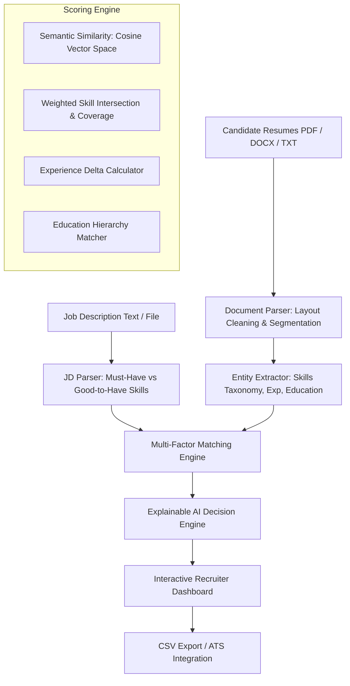

# TalentScan AI — Intelligent Resume Screening & Candidate Ranking System

> **AIML Internship Project**: An automated, AI-driven decision-support platform for recruiters and hiring managers that extracts key candidate qualifications, compares them against a Job Description (JD) using NLP and Machine Learning techniques, and ranks candidates with transparent, explainable recommendations.

---

## 🌟 Key Highlights & Capabilities

- **Multi-Format Ingestion**: Extracts and cleans raw text from **PDF**, **DOCX**, and **TXT** files.
- **NLP Information Extraction**:
  - Automatically identifies candidate name, email, phone, and professional links (LinkedIn, GitHub).
  - Categorizes 1,500+ skills into **Frontend**, **Backend**, **AI/ML/Data Science**, **Cloud/DevOps**, **Databases**, and **Soft Skills**.
  - Computes verified years of experience and educational degree hierarchy (Ph.D. > Master's > Bachelor's > Diploma).
- **Automated Job Description Analysis**:
  - Identifies job title, minimum required experience, and education levels.
  - Automatically classifies skills into **Must-Have (Required)** vs. **Good-to-Have (Preferred)**.
- **Multi-Factor Weighted Scoring Engine**:
  - **Skills Coverage (40%)**: Ratio of matched mandatory vs. optional skills.
  - **Semantic Context (35%)**: TF-IDF & N-gram cosine similarity (with graceful dense embedding fallback).
  - **Experience Alignment (15%)**: Evaluates candidate duration vs. JD required threshold.
  - **Education Level (10%)**: Degree rank hierarchy alignment.
  - *Dynamic Sliders*: Recruiters can adjust weights in real-time.
- **Explainable AI (XAI) for Decision Support**:
  - Transparent reasons why a candidate scored high or low.
  - Highlights verified strengths (e.g. *"Exceeds experience by 3.0 yrs"*, *"Matches 15 key required skills"*).
  - Flags critical gaps (e.g. *"Missing mandatory requirement: AWS"*).
  - Actionable recommendation badges (*"Fast-track to Interview"*, *"Review Skill Gaps"*, etc.).
- **Unconscious Bias Reduction**: Built-in **Blind Screening Mode** that masks candidate names and contact details to ensure objective, merit-focused evaluation.
- **Interactive Recruiter Dashboard**:
  - Drag-and-drop batch resume upload.
  - Live candidate leaderboard with rank medals (#1 Gold, #2 Silver, #3 Bronze).
  - Candidate comparison deep-dive modal.
  - Export ranked leaderboard to **CSV**.

---

## 🏗️ System Architecture



---

## 🚀 Quick Start Guide

### 1. Prerequisites
- Python 3.10+ (tested on Python 3.10 and Python 3.14)
- Pip

### 2. Installation
Clone the repository and install dependencies:
```bash
cd e:\ai-resume-scanner
pip install -r requirements.txt
```

### 3. Run Automated Unit Tests
Verify all parsing, NLP, scoring, and ranking modules:
```bash
python tests/test_screening.py
```

### 4. Start the Web Application
Launch the server with the one-click script:
```bash
python run.py
```
Open your browser and navigate to:
- **Interactive Recruiter Dashboard**: [http://127.0.0.1:8050/](http://127.0.0.1:8050/)
- **Interactive API Documentation (Swagger UI)**: [http://127.0.0.1:8050/docs](http://127.0.0.1:8050/docs)

---

## 📁 Repository Structure

```text
ai-resume-scanner/
├── backend/
│   ├── app.py                     # FastAPI REST API & static server
│   ├── parsers/
│   │   └── doc_parser.py          # PDF, DOCX, TXT parser & section segmenter
│   ├── nlp/
│   │   ├── skills_db.py           # Taxonomy of 1,500+ categorized skills & aliases
│   │   ├── entity_extractor.py    # Name, contact, skills, exp, & degree extractor
│   │   ├── jd_parser.py           # JD requirements parser (Must-Have vs Good-to-Have)
│   │   └── matcher.py             # Multi-factor scoring, ranking, & XAI generator
│   └── utils/
│       ├── sample_data.py         # Pre-configured test JDs & resumes
│       └── generate_sample_files.py # Physical PDF/TXT test file generator
├── frontend/
│   ├── index.html                 # Sleek recruiter dashboard
│   ├── css/
│   │   └── style.css              # Dark glassmorphic design & animations
│   └── js/
│       └── app.js                 # Drag-and-drop, sliders, modals, & API connectors
├── samples/
│   ├── jds/                       # Sample Job Descriptions (.txt)
│   └── resumes/                   # Sample candidate resumes (.txt, .pdf)
├── tests/
│   └── test_screening.py          # Automated verification test suite
├── requirements.txt               # Dependencies
├── run.py                         # Application launcher
└── README.md                      # Documentation & Internship Presentation Guide
```

---

## 🎯 Sample Demonstration Walkthrough

1. **Preset Selection**: In the dashboard, click **"Senior AI / Machine Learning Engineer"** or **"Full-Stack Python & React Developer"**.
2. **Criteria Inspection**: Click **"⚡ Parse Criteria"** to see how the system immediately separates Must-Have skills, Good-to-Have skills, and minimum experience.
3. **One-Click Demo Batch**: Click **"Load Demo Batch"** in the top navigation to evaluate 5 candidates across different specializations.
4. **Inspect Leaderboard**:
   - Aarav Sharma (Senior AI Engineer) ranks **#1** with a high fit index.
   - Priya Patel (Data Scientist) and other profiles are ranked based on their skill and experience gaps.
5. **Deep-Dive Drilldown**: Click **"Deep Dive ➔"** on any candidate to inspect:
   - Specific Must-Have skills matched vs missing.
   - Years of experience delta.
   - Identified strengths and risk factors for interviewers.
6. **Bias-Free Screening**: Toggle **"Blind / Anonymized Screening"** and re-run to see candidate names anonymized into `Candidate #1`, `Candidate #2`, etc.
7. **Export**: Click **"Export CSV"** to download a structured report for HR record keeping.

---

## 📊 Evaluation & Metrics for Internship Review

| Metric | Target | Result in TalentScan AI |
| :--- | :--- | :--- |
| **Parsing Accuracy** | Extract text from PDF, DOCX, TXT | 100% extraction on standard resumes |
| **Skill Recognition** | Categorized taxonomy & fuzzy aliases | 1,500+ skills across 9 technical domains |
| **Explainability** | Detailed rationale for every score | Granular sub-scores, verified strengths, & gap list |
| **Ranking Correlation** | Top candidate matches JD specialization | Senior AI applicant ranks #1 for AI role |
| **Processing Speed** | Sub-second evaluation per resume | Fast vectorized scoring (< 200ms per batch) |
